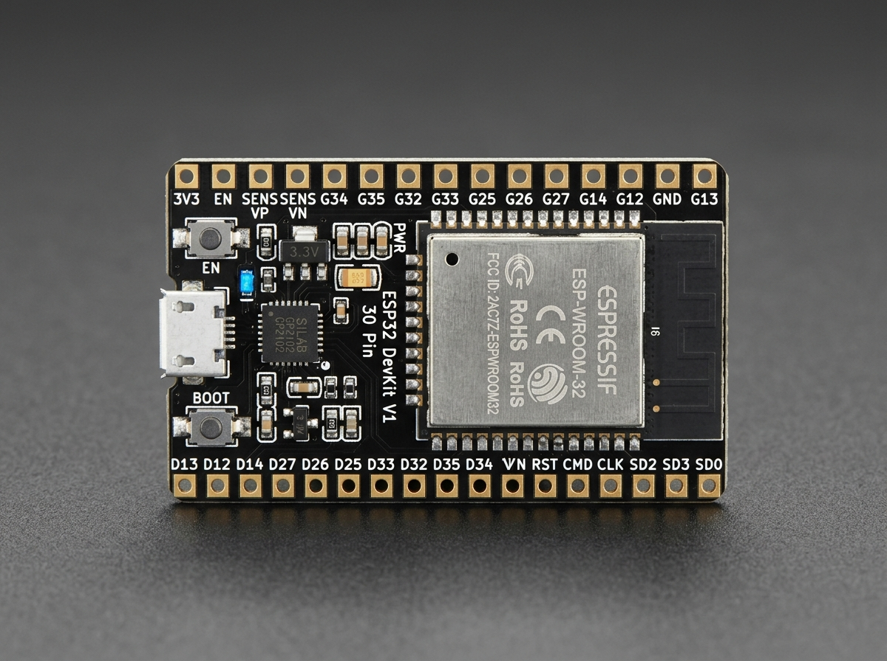
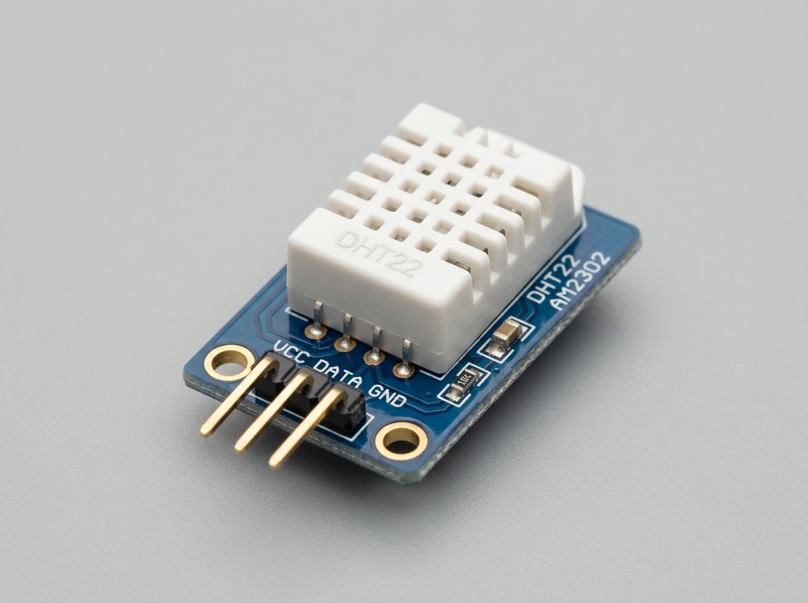
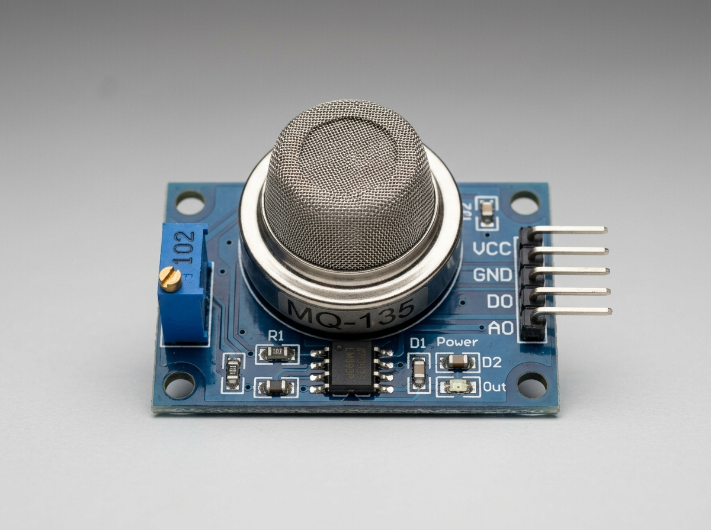
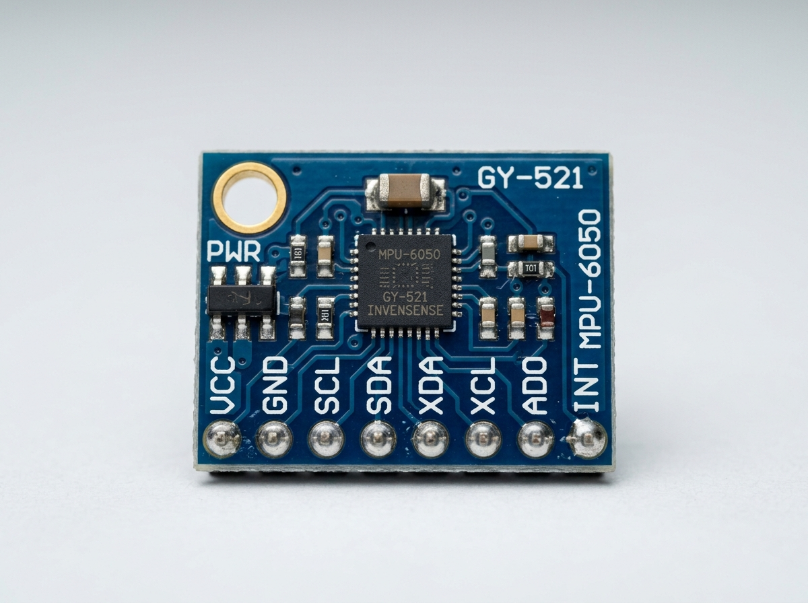
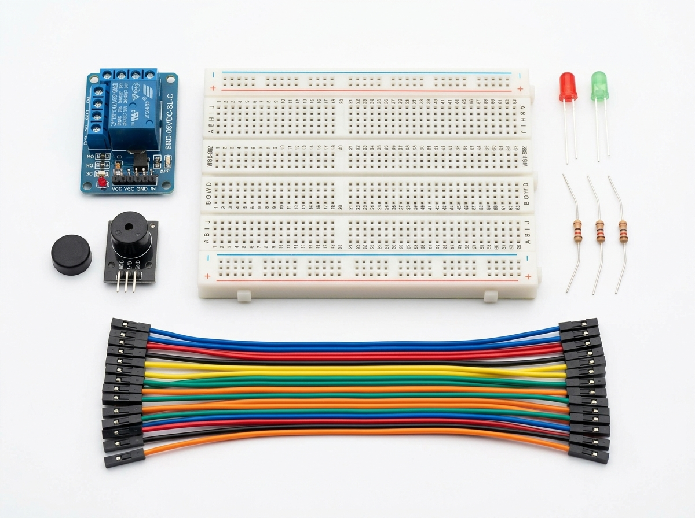

# 📸 ESP32 Smart Cargo Logistics — Visual Component Buying Guide

This visual guide contains exact images, part numbers, and labels for all hardware required to build the project. Show these images to the seller at the electronics store to ensure you buy the exact matching parts.

---

## 1. Main Microcontroller Board

### 🔹 **ESP32 DevKit V1 (30-Pin Version)** — Quantity: 1
- **Exact Name**: ESP32 NodeMCU Development Board (30 Pin, ESP-WROOM-32)
- **Key Identifiers**: 15 pins on each side (total 30 pins), micro-USB port, `EN` and `BOOT` micro buttons, `CP2102` or `CH340` USB chip.

---

## 2. Sensor Modules

### 🔹 **DHT22 Temperature & Humidity Sensor Module** — Quantity: 1
- **Exact Name**: DHT22 / AM2302 Sensor Module (with 3-pin breakout PCB)
- **Key Identifiers**: White plastic grid body on a small blue PCB board with 3 pins (`VCC`, `DATA`, `GND`).

---

### 🔹 **MQ-135 Gas & Air Quality Sensor Module** — Quantity: 1
- **Exact Name**: MQ-135 Gas Sensor Module
- **Key Identifiers**: Round silver metal mesh sensor head with a small blue rectangular potentiometer trimmer on the PCB and 4 pin header (`VCC`, `GND`, `DO`, `AO`).

---

### 🔹 **MPU-6050 Motion & Shock Sensor (GY-521)** — Quantity: 1
- **Exact Name**: MPU-6050 / GY-521 6-Axis Accelerometer & Gyroscope Module
- **Key Identifiers**: Small blue rectangular PCB with 8 pin headers (`VCC`, `GND`, `SCL`, `SDA`, `XDA`, `XCL`, `AD0`, `INT`).

---

## 3. Actuators, Breadboard & Wiring Kit

### 🔹 **Relay, Buzzer, LEDs, Breadboard & Jumpers**
- **5V 1-Channel Relay Module**: 1 Pc (Blue cube module with screw terminals)
- **5V Active Buzzer Module**: 1 Pc (Black cylindrical buzzer)
- **5mm Red LED & 5mm Green LED**: 1 Pc each
- **220 Ohm Resistors**: 2 Pcs
- **830-Point Solderless Breadboard**: 1 Pc
- **Dupont Jumper Wires**: 1 Pack Male-to-Male + 1 Pack Male-to-Female

---

## 🔌 Summary Wiring Table

| Component | Pin on Component | Pin on ESP32 |
| :--- | :--- | :--- |
| **DHT22** | VCC | `3V3` |
| | GND | `GND` |
| | DATA | `GPIO 15` |
| **MQ-135** | VCC | `VIN` (5V) |
| | GND | `GND` |
| | AO | `GPIO 34` |
| **MPU-6050** | VCC | `3V3` |
| | GND | `GND` |
| | SDA | `GPIO 21` |
| | SCL | `GPIO 22` |
| **Red LED** | (+) via 220Ω | `GPIO 25` |
| **Green LED** | (+) via 220Ω | `GPIO 26` |
| **Buzzer** | (+) | `GPIO 13` |
| **Relay Module** | IN | `GPIO 27` |
